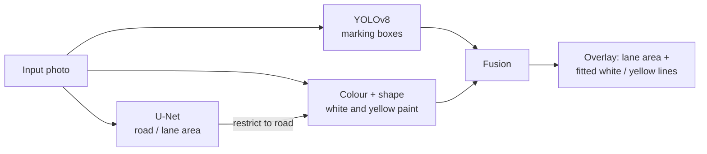

# Road Lane Detection: White and Yellow, Straight and Curved

[](https://colab.research.google.com/drive/1Sgk9V2uwQZmPoBzD643ZTUgJnEtflJdk?usp=sharing)


A hybrid computer-vision pipeline that detects lane markings on road photos and shows which part of the road is the driving lane. It combines two trained neural networks with a colour-and-curve-fitting stage, so it handles white and yellow paint, dashed and solid lines, and straight and curved roads.

> **Legend:** green = ego lane, blue = other lanes, red boxes = YOLO detections, **cyan lines = white paint, orange lines = yellow paint**.

---

## Table of contents
1. [Why a hybrid pipeline](#why-a-hybrid-pipeline)
2. [How it works](#how-it-works)
3. [Results](#results)
4. [Datasets](#datasets)
5. [Repository structure](#repository-structure)
6. [Quick start](#quick-start)
7. [What to run, and when](#what-to-run-and-when)
8. [Using the trained models](#using-the-trained-models)
9. [Tuning and troubleshooting](#tuning-and-troubleshooting)
10. [Limitations](#limitations)
11. [Roadmap](#roadmap)
12. [Acknowledgements and licences](#acknowledgements-and-licences)

---

## Why a hybrid pipeline

The available labelled data is small and uneven:

- The box dataset has 50 photos, mostly dashed white markings in close-range street scenes, and almost no yellow or curved lines.
- The KITTI dataset labels the **lane area**, not the painted lines.

A single detector trained on this data fails on scenes outside it (wide highway shots, double yellow lines, bends). The pipeline therefore splits the problem into three parts. Each part uses the information that is actually available for it.

## How it works



| Stage | Role | Learns from | Output |
|---|---|---|---|
| **YOLOv8s** | Detects pieces of lane marking | Box dataset (50 photos) | Bounding boxes |
| **U-Net (ResNet-34 encoder)** | Segments ego lane, other lanes, background | KITTI Road (289 photos) | Per-pixel road mask |
| **Colour and curve finder** | Extracts white and yellow paint inside the road mask and fits smooth curves | No training (image processing) | Lines with colour label |

**Colour and curve finder, in brief.** White paint is isolated with a top-hat filter combined with low saturation and high brightness. Yellow paint is isolated by hue in HSV space. Thin, non-horizontal blobs are reduced to centre-line points. A sequential RANSAC fits `x = a·y² + b·y + c` to those points. Straight lines emerge as `a ≈ 0`, bends as `a ≠ 0`, and a curvature cap rejects unrealistic fits.

**Fusion rule.** A fitted curve is kept if it spans at least 22 % of the image height, or if at least two YOLO boxes lie on it. This removes short, unsupported streaks.

**Training details.**
- YOLOv8s: 1280 px input, up to 150 epochs with early stopping, mosaic / mixup / HSV / rotation / scale augmentation, cosine learning-rate schedule.
- U-Net: ImageNet-pretrained encoder, Cross-Entropy + Dice loss, flip / zoom-crop / brightness augmentation, OneCycle schedule, best checkpoint chosen by validation mIoU. Test-time augmentation (horizontal flip) is used at inference.

## Results

Metrics are measured on held-out validation images that were never used for training. Fill in the values printed by the final report card (Step 18 of the notebook).

| Component | Metric | Value |
|---|---|---|
| YOLOv8s marking detector | mAP@50 | `0.xxx` |
| YOLOv8s marking detector | Precision / Recall | `0.xxx` / `0.xxx` |
| U-Net road / lane area | mIoU (3 classes) | `0.xxx` |
| U-Net road / lane area | IoU: background / ego lane / other lane | `0.xxx` / `0.xxx` / `0.xxx` |
| Full pipeline | Labelled marking pieces found (YOLO or fitted curve) | `xx.x %` |

> The last row is a practical proxy: a labelled box counts as found if a YOLO box overlaps it (IoU ≥ 0.3) or a fitted curve passes through it. It is not a standard benchmark metric. The validation set is small (10 photos), so treat all numbers as indicative.

## Datasets

No data is committed to this repository. See [`data/README.md`](data/README.md) for the expected layout.

| Dataset | Content | Used for |
|---|---|---|
| Road-line boxes | 50 photos, Pascal VOC XML, one class (`road_line`), 172 boxes | YOLOv8 |
| KITTI Road, 224×224 copy | 289 labelled photos (ego lane / other lane / background masks) and an unlabelled test folder | U-Net |

Pre-processing handled by the notebook:
- **EXIF rotation** is applied before any label is read. Most phone photos in the box dataset carry a rotation flag, and the boxes are drawn on the rotated image.
- Large photos are downscaled to 1280 px on the long side.
- VOC boxes are converted to YOLO format; the split is 80 % train / 20 % validation with a fixed seed.
- KITTI mask colours are decoded into class ids with brightness thresholds, because the 224 px copy has blurred mask edges.
- Duplicate zip uploads are detected by checksum and skipped.

## Repository structure

```
road-lane-detection/
├── notebooks/
│   └── road_lane_detection_full_project.ipynb   # the complete pipeline (run this)
├── data/
│   └── README.md                                # where to obtain the datasets
├── docs/
│   └── images/                                  # screenshots used in this README
├── models/                                      # trained weights (not committed; see Releases)
├── requirements.txt
├── LICENSE
└── README.md
```

## Quick start

The notebook is written for **Google Colab** (free T4 GPU is sufficient).

1. Click the **Open in Colab** badge at the top of this page.
2. Select `Runtime → Change runtime type → T4 GPU`.
3. Download the two datasets (links in [`data/README.md`](data/README.md)) and keep the zip files ready.
4. Run the notebook from top to bottom (`Runtime → Run all` also works, but you must upload files when Steps 2 and 17 ask).

Total runtime on a T4 is roughly 30–45 minutes, dominated by YOLO training.

> Running locally is possible, but the upload cells use `google.colab.files`. Replace Steps 2 and 17 with local paths and install `requirements.txt` in an environment with a CUDA GPU.

## What to run, and when

Run the cells in order. Times are approximate for a Colab T4.

| Step | Cell purpose | Approx. time | You should see |
|---|---|---|---|
| 1 | Check GPU, install `ultralytics` and `segmentation-models-pytorch` | 1–2 min | `GPU available: True` |
| 2 | Upload zips, remove duplicates, extract, detect dataset type | 1–3 min | `{'…': 'boxes', '…': 'lane_masks'}` |
| 3 | Convert VOC boxes to YOLO format, split train / val | < 1 min | Per-dataset image and box counts |
| 4 | Visual check of converted labels | seconds | Photos with green boxes on the paint |
| 5 | **Train YOLOv8s** | 15–30 min | Epoch table with rising `mAP50` |
| 6 | Evaluate YOLO on validation photos | < 1 min | Precision, Recall, mAP50, training curves |
| 7 | Load KITTI photos and decode masks | < 1 min | `Loaded 289 image/mask pairs`, tinted examples |
| 8 | Build U-Net, augmentations, loss, metric | seconds | `U-Net ready.` |
| 9 | **Train U-Net** | 3–6 min | Loss falling, mIoU rising |
| 10 | Evaluate U-Net, define `predict_road()` | < 1 min | Per-class IoU, prediction vs. truth |
| 11–13 | Define the colour and curve finder | instant | No output (function definitions) |
| 14 | Define `detect_lanes()` and the visualiser | instant | `Lane detector ready` |
| 15 | Test on held-out photos, print the found-marking score | ~1 min | Four-panel results and score lines |
| 16 | Test on unlabelled KITTI photos | seconds | Four-panel results |
| 17 | **Upload your own photos** | interactive | Four-panel results per photo |
| 18 | Print report card, download both model files | seconds | `best.pt`, `unet_best.pth` |

**Do not skip Steps 2–4 before training**, and always run Steps 11–14 before Steps 15–17 (they define the functions the tests use).

## Using the trained models

After Step 18 you have two files: `best.pt` (YOLO) and `unet_best.pth` (U-Net).

```python
import torch, cv2
import segmentation_models_pytorch as smp
from ultralytics import YOLO

yolo = YOLO("best.pt")
boxes = yolo.predict("road.jpg", imgsz=1280, conf=0.15)[0].boxes.xyxy

unet = smp.Unet("resnet34", encoder_weights=None, in_channels=3, classes=3)
unet.load_state_dict(torch.load("unet_best.pth", map_location="cpu"))
unet.eval()
```

The full inference function, `detect_lanes()`, which also runs the colour and curve stage and the fusion rule, is defined in Steps 11–14 of the notebook.

Weights are not stored in the repository (the U-Net file is close to GitHub's 100 MB limit). They are published under **Releases**.

## Tuning and troubleshooting

| Symptom | Likely cause | What to change |
|---|---|---|
| `GPU available: False` | CPU runtime selected | `Runtime → Change runtime type → T4 GPU` |
| CUDA out of memory during YOLO training | Batch too large at 1280 px | `batch=4` (Step 5) |
| Skipped labels reported in Step 3 | Class names in a new dataset are not in `NAME_MAP` | Add them to `NAME_MAP` / `CLASS_NAMES` |
| `No KITTI-style dataset found` | Wrong zip uploaded | Upload the zip containing `gt_image_2/` |
| Lines drawn on trees or grass | Road mask too large | Check panel 2; train the U-Net longer or add similar road photos |
| Real line missing | Faint or distant paint | Lower `min_len_frac` in `fuse_with_boxes`, or lower `yolo_conf` |
| Many short false lines | Fusion too permissive | Raise `min_len_frac` (e.g. 0.30) |
| Yellow line not found | Pale or orange-shifted yellow | Widen the hue range in `marking_pixels` |

## Limitations

- **Small training sets.** 50 box-labelled and 289 mask-labelled photos. Scores on a 10-photo validation split are noisy.
- **Yellow and curved lines are not learned.** They are handled by the rule-based stage, which is sensitive to lighting and paint condition.
- **Domain gap.** The road-area model is trained on German urban roads (KITTI). Accuracy on very different scenes (rural, heavy rain, night) is expected to be lower.
- **Single frame.** Each image is processed independently; there is no temporal smoothing for video.
- **Curve model.** A second-order polynomial per line; sharp S-bends and merging lanes are approximated.

## Roadmap

- [ ] Add a separate `yellow_line` class and labelled yellow / curved examples
- [ ] Train on a larger lane dataset (e.g. TuSimple, CULane, BDD100K, Indian Driving Dataset)
- [ ] Video inference with temporal smoothing
- [ ] Export to ONNX / TensorRT for edge devices
- [ ] Standalone inference script (`python detect.py --image road.jpg`)

## Acknowledgements and licences

- **Datasets:** the road-line box dataset (`[add source and licence]`) and the KITTI Road benchmark (A. Geiger, P. Lenz, R. Urtasun; J. Fritsch, T. Kuehnl, A. Geiger, ITSC 2013), released under CC BY-NC-SA 3.0 (non-commercial use).
- **Libraries:** [Ultralytics YOLOv8](https://github.com/ultralytics/ultralytics) (AGPL-3.0), [segmentation-models-pytorch](https://github.com/qubvel-org/segmentation_models.pytorch) (MIT), [OpenCV](https://opencv.org/) (Apache-2.0), PyTorch.
- The code in this repository is released under the **MIT License** (see [`LICENSE`](LICENSE)). Note that the Ultralytics dependency and the KITTI data carry their own terms, which apply to any use of the trained weights.

## Author

**Prateek Pandey**: [GitHub](https://github.com/ppandey6602) · [LinkedIn](https://www.linkedin.com/in/prateek-pandey-24aa84222)
